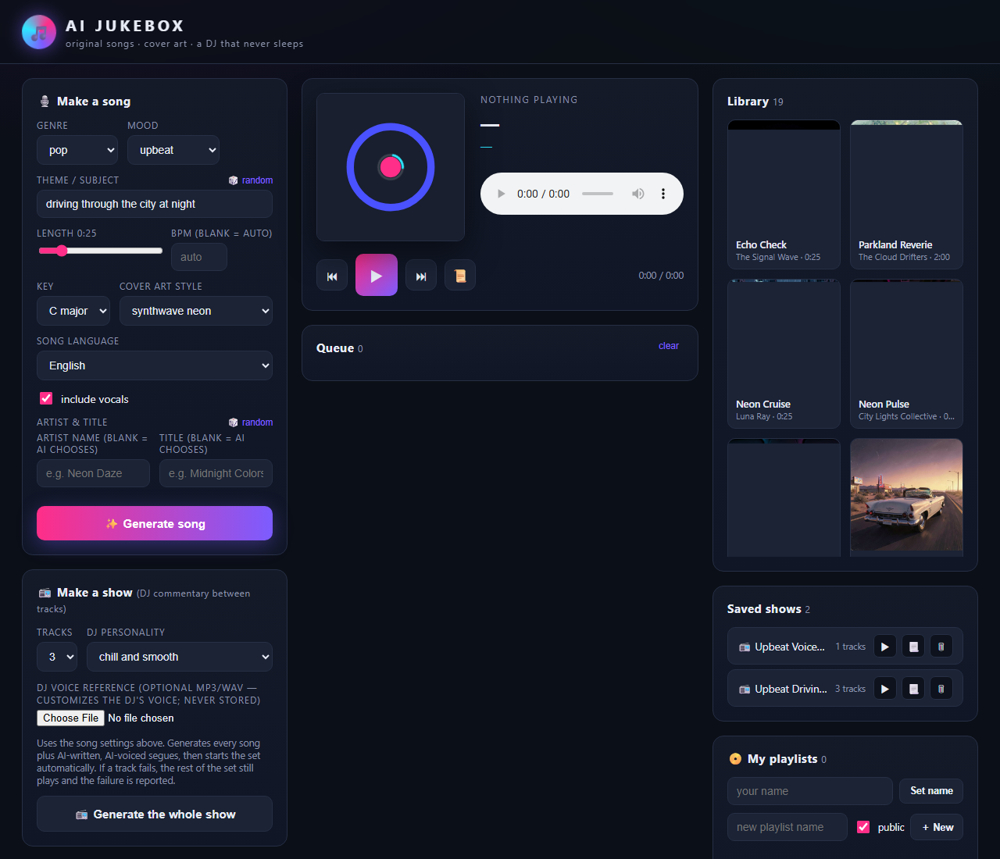
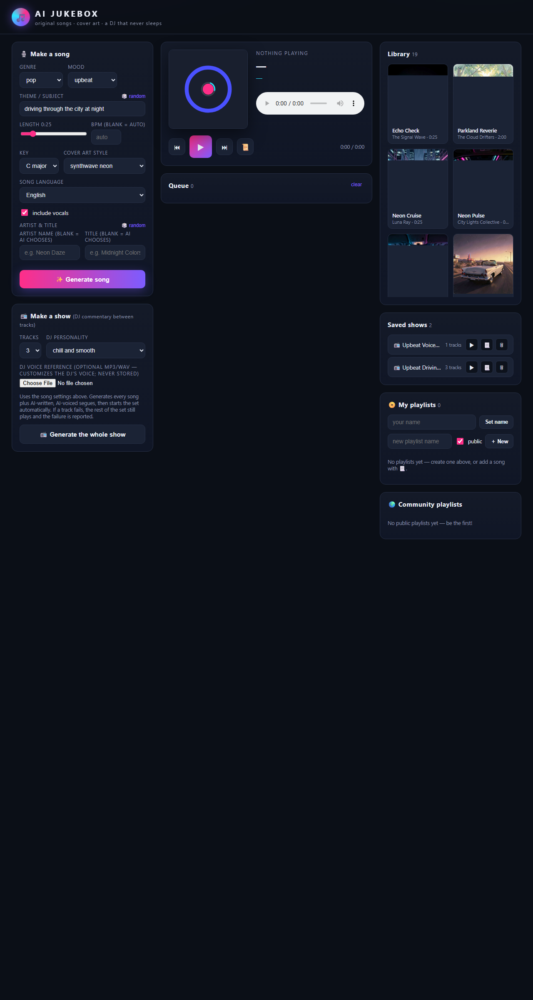

# AI Jukebox 🎵

An AI that writes, performs, and DJs your music. Generate a customizable song
(lyrics + music + cover art), then assemble a whole radio set where an
AI-generated DJ voices commentary between every track.

Everything runs against **class services only** — no paid APIs, no port 9000.

| Feature | Class service | Port | Used for |
|---|---|---|---|
| Text generation | Qwen3.6-35B-A3B | 9001 | lyrics, song captions, DJ scripts |
| Cover art | FLUX.2 klein 4B | 9006 | album artwork for every song |
| Music | ACE-Step 1.5 XL Turbo | 9007 | composing the actual songs |
| DJ speech | Chatterbox Multilingual V3 | 9008 | spoken commentary between tracks |

## Quick start

```bash
git clone <this-repo> && cd ai-jukebox

python3 -m venv .venv && source .venv/bin/activate
pip install -r requirements.txt

cp .env.example .env        # then fill in your class endpoint URLs + API key
python scripts/smoke_test.py   # optional: verify all 4 services respond

uvicorn backend.app:app --reload
# open http://127.0.0.1:8000
```

## What you can do

- **Make a song** — pick genre, mood, theme, length, BPM, key, cover style;
  the app writes original lyrics, composes the music, and paints the cover.
- **Library** — every generation is stored locally (cover + audio + lyrics)
  and playable from the browser.
- **Make a show** — choose 2–5 tracks and a DJ personality. The app generates
  the whole set plus AI-written, AI-spoken segues, then plays it end to end:
  opener → track → segue → track → … Optionally attach an **MP3/WAV voice
  reference** to customize the DJ's voice (forwarded to the class voice
  service, never stored or committed). If a track fails to generate, the rest
  of the set still plays and the failure is reported in the saved show.

## Screenshots





### Sample songs (ready to play)

The repo bundles **three sample songs** under `samples/` — short tracks with
covers, generated in advance using the class endpoints (Qwen 9001 lyrics,
FLUX 9006 covers, ACE-Step 9007 music):

| Song | Artist | Style | Length |
|---|---|---|---|
| Neon Pulse Drive | Luna Ray | pop · upbeat | 0:32 |
| Midnight Rain Glass | Echo Chamber | ambient · chill | 0:40 |
| Neon Last Ride | Synthwave Echoes | electronic · nostalgic | 0:35 |

On first startup the app copies them into your library automatically
(`backend/samples.py`, idempotent — already-present sample ids are skipped),
so a fresh clone has three **ready-to-play** songs with titles and covers
immediately, no generation call required to hear them. Covers are bundled at
512×512 JPEG to keep the repo light; the MP3s themselves are the original
class-service renders.

**How they were generated:** each sample went through exactly the same class
pipeline the app uses — **Qwen (9001)** wrote the title, artist, lyrics,
production caption, and cover prompt from the genre/mood/theme specs;
**ACE-Step (9007)** composed the audio (`audio_duration` 32–40s);
**FLUX (9006)** painted the cover. Fixed seeds (6418, 2026, 42) were used for
reproducible output; `samples/manifest.json` records each song's full lyrics,
caption, cover prompt, seed, and music metadata.

## API

| Method | Path | Description |
|---|---|---|
| GET | `/api/health` | class-service status dashboard |
| POST | `/api/songs` | generate one song (see body schema in `backend/app.py`) |
| GET | `/api/songs` / `/api/songs/{id}` | list / fetch songs |
| DELETE | `/api/songs/{id}` | remove a song |
| POST | `/api/shows` | generate a DJ'd collection (`n_tracks`, `dj_vibe`, …) |
| GET | `/api/shows` / `/api/shows/{id}` | list / fetch shows |
| GET | `/media/...` | generated audio / cover files |

## How a song is made

1. **Qwen** (9001) writes original lyrics, a production caption, and a cover
   prompt from your specs (single JSON call, server-side).
2. **ACE-Step** (9007) composes the track: `release_task` → poll
   `query_result` → download the finished MP3.
3. **FLUX** (9006) paints the cover from the prompt (steps 1 & 2 run in parallel).
4. Everything is saved under `storage/` and indexed in `storage/library.json`.
5. For a **show**, **Qwen** writes an opener + segues referencing each real track
   (including a snippet of each track's production caption, so the commentary
   is song-specific), and **Chatterbox** (9008) voices them between the songs.
   DJ speech tempo can be tuned with `JUKEBOX_DJ_SPEED` (0.25–4.0; below 1
   slows the DJ down). An optional `voice_ref_b64` (base64 MP3/WAV) is
   forwarded to the voice service as `ref_audio` for every line of a show to
   customize the voice — it is never written to disk and never committed.
6. **Failure tolerance:** if one track in a show fails, the set still
   generates with the remaining tracks; `show["errors"]` lists what was
   skipped. Only when *every* track fails does the show request fail.

## Tests

```bash
pip install -r dev-requirements.txt   # pytest (dev only)
python -m pytest tests/ -q
```

The suite runs fully offline (class services mocked): sample-song seeding +
idempotency, the 9008 speech payload (voice reference / speed fields), and
show-generation failure recovery.

## Test results and evidence

Every check below was reproduced against the live class endpoints
(ports 9001/9006/9007/9008) or the offline test suite. "Expected" is taken
from the assignment spec; "Actual" is what we observed.

| # | Feature / check | Input | Expected | Actual | Result |
|---|---|---|---|---|---|
| 1 | Song generation — duration cap | `POST /api/songs`, `duration=121` | rejected (max 2 min) | HTTP 422 validation error | ✅ passed |
| 2 | Song generation — stated maximum | `POST /api/songs`, `duration=120`, instrumental | 2:00 playable song | 200 OK, "Two Minute Rush", service-reported 120.0s audio | ✅ passed |
| 3 | Song generation — vocal + lyrics | generate with vocals on | AI-written lyrics, sung audio | Qwen lyrics + ACE-Step vocal audio (e.g. "Neon Pulse Drive") | ✅ passed |
| 4 | Cover art per song | generate with a cover style | new FLUX cover matching theme, shown with the track | unique cover per song, displayed in library + player | ✅ passed |
| 5 | Sample songs ready-to-play | fresh empty storage + app start | exactly 3 samples with titles + covers | 3 seeded on startup; re-seed adds 0 (idempotent) | ✅ passed |
| 6 | DJ show with voice reference | `POST /api/shows`, `n_tracks=1`, base64 MP3 reference | DJ opener spoken in the referenced voice | 200 in 20s, `errors: []`, opener = valid MP3 (ID3, 240 KB) | ✅ passed |
| 7 | DJ speech speed | `JUKEBOX_DJ_SPEED=0.9` | speech tempo at 0.9× | voice service accepted `speed=0.9` on every DJ line | ✅ passed |
| 8 | Failure case — all tracks fail | simulated service outage in show | readable error, no partial show saved | `ServiceError: all 3 tracks failed` (test suite) | ✅ passed |
| 9 | Failure case — one of three tracks fails | 1 failing track in a show | rest of set still plays; failure reported | 2-track show generated, failure listed in `errors` | ✅ passed |
| 10 | Offline test suite | `python -m pytest tests/ -q` | all pass, no network | 9 passed (0.43s) | ✅ passed |

### Unresolved problems and unchecked claims

- **Per-track progress is not streamed.** A show request is one synchronous
  call; showing per-track progress would require a job/poll redesign. Status is
  currently a single "Broadcasting…" state.
- **A multi-track show with a voice reference has not been run end to end.**
  The live voice-reference test used `n_tracks=1` (one song + opening); a 3+
  track set with a reference clip is unchecked.
- **DJ pacing is a judgment call.** The `JUKEBOX_DJ_SPEED` knob is verified to
  reach the service, but no A/B listening test of a full set has been recorded.
- **Voice-reference quality depends on the clip** (short, clean speech works
  best); no recommendation is enforced in the UI.

### Design judgment

**Choice — voice references travel as base64 in the request and are never
stored.** The class voice service requires base64 reference audio (`ref_audio`,
"no URLs or paths"), so the browser base64-encodes the picked MP3/WAV and
sends it inside the show request; the server forwards it verbatim on every
speech call and discards it. This keeps user content off the server disk
(which the assignment's safeguards require for uploads), avoids cleanup and
multi-user isolation problems, and matches the service contract exactly.
Evidence: check #6 above and `tests/test_speak.py`.

**Limitation investigated — one-word DJ segues.** During show testing the DJ
sometimes produced lines like "…" or a single word, which broke the radio
format. This was investigated in `fix/dj-transitions`: the fix added
`_valid_script` (minimum length/word counts plus a forbidden-placeholder
list) and a retry loop that re-prompts the model with a corrective nudge, so
a placeholder can never reach the player — the same validation/retry pattern
now guards the whole show pipeline. Lesson: generation services need output
*validation and retry*, not just error handling.

## Safeguards (per assignment spec)

- Credentials live **server-side only**: `JUKEBOX_API_KEY` comes from `.env`
  (gitignored). Configuration examples use placeholders only
  (`.env.example`, `class-endpoints.txt.example`).
- No user uploads or voice recordings are accepted or stored by the app.
- No third-party music, lyrics, cover art, or voice samples are bundled —
  everything is generated on demand by the class services.
- Port 9000 is never used for app requests. No paid services anywhere.

## Project layout

```
backend/
  config.py     env-driven endpoints, key, storage
  services.py   HTTP clients for the four class services
  prompts.py    songwriter & DJ prompt templates
  generator.py  song + show pipelines
  store.py      local library persistence (storage/ is gitignored)
  app.py        FastAPI app & routes
static/         browser UI (vanilla JS player + jukebox controls)
scripts/
  smoke_test.py end-to-end class-service check
```
